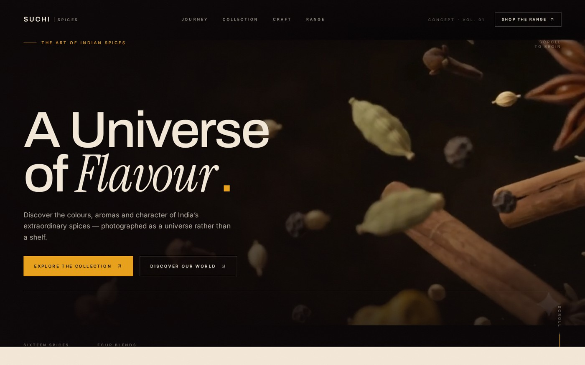

# SUCHI SPICES — A Universe of Flavour

A fictional premium Indian spice brand, built end to end as a portfolio piece: a full
campaign art direction, 15 generated visual assets, and an immersive scroll-driven website.



---

## What's in here

```
suchi-spices/
├── assets/              # 15 original campaign images (full resolution JPEG)
├── preview/             # web-weight derivatives used by the asset index
├── audit/               # screenshots from the verified test runs
├── ART-DIRECTION.md     # palette, type scale, packaging system, motion language
├── index.html           # standalone asset index / campaign bible (self-contained)
└── site/                # the React application
    ├── public/
    │   ├── images/      # responsive WebP + JPEG derivatives (3 widths each)
    │   ├── videos/      # hero video + posters
    │   └── fonts/       # self-hosted Archivo, Inter, Instrument Serif
    ├── src/
    │   ├── components/  # 11 section components + 3 UI primitives
    │   ├── data/        # generated asset manifest, product data
    │   ├── hooks/       # reduced motion, media query, smooth scroll
    │   ├── lib/         # GSAP registration
    │   └── styles/      # Tailwind 4 theme + design tokens
    ├── scripts/audit.py # Playwright visual/behaviour audit
    └── README.md        # full build notes, asset map, test results
```

## Run the site

```bash
cd site
npm install --legacy-peer-deps
npm run dev        # http://localhost:5173
```

Production build:

```bash
npm run build      # → site/dist
npm run preview    # http://localhost:4173
```

> `--legacy-peer-deps` is needed on npm 10.8.x, which cannot resolve Vite 8's optional peer
> tree. See `site/README.md`.

## The 15 assets

| # | Asset | Ratio |
|---|---|---|
| 01 | Cinematic hero keyframe | 16:9 |
| 02 | Hero alternative | 16:9 |
| 03 | Red Chilli Powder — packaging | 4:5 |
| 04 | Turmeric Powder — packaging | 4:5 |
| 05 | Garam Masala — packaging | 4:5 |
| 06 | Coriander Powder — packaging | 4:5 |
| 07 | The Great Spice Explosion | 16:9 |
| 08 | Golden Spice World | 16:9 |
| 09 | Aromatic Dark Spices | 16:9 |
| 10 | Authentic Indian Cooking | 16:9 |
| 11 | Ingredients and Heritage | 16:9 |
| 12 | Signature Brand Still Life | 16:9 |
| 13 | Abstract Spice Background | 16:9 |
| 14 | Wide Ingredient Panorama | 21:9 |
| 15 | Closing Campaign Image | 16:9 |

Open `index.html` in a browser to browse them with their colour system and usage notes.

## Credits & disclosure

**This is a fiction.** Suchi Spices is not a real brand; the four products, their packaging
and all copy were invented for a portfolio demonstration. Nothing is for sale. There are no
certifications, awards, health claims, real testimonials or sourcing claims anywhere in the
project.

- Campaign imagery, packaging and hero footage were created with generative models for this
  project and are not real product photography.
- The hero video carries a small watermark from the generating tool.
- Typefaces: Archivo, Inter and Instrument Serif (SIL Open Font License), self-hosted.
- Code: React, Vite, Tailwind CSS, GSAP, Lenis, Lucide.

## Licence

Source code is offered under the MIT licence for portfolio reference. The generated
campaign imagery is included for demonstration only — please do not reuse it as stock
photography.
